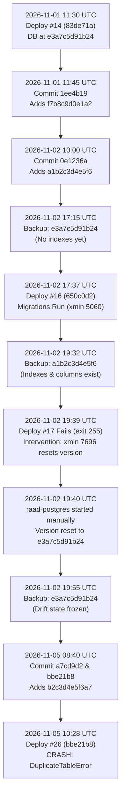

# RAAD-TECH — Production VPS Read-Only Forensic Audit Report

**Document Title:** Production VPS Read-Only Forensic Audit: Alembic Migration Failure & Container Architecture Analysis  
**File Name:** `RAAD-PRODUCTION-MIGRATION-FORENSIC-AUDIT.md`  
**Date of Audit:** 2026-11-05  
**Audit Conducted By:** Senior DevOps Engineer, PostgreSQL DBA, Alembic Migration Specialist & Backend Architect  
**Audited Target:** RAAD-TECH Production VPS (`srv2082072` / `72.62.7.212`), Coolify 4.6.0, Resource `m0lhtrori7rbplpzwzilohfz`  
**Target Environment:** Production (`main` branch @ commit `bbe21b8e223f8c2911da894b875643608b6ed7b8`)  
**Audit Policy:** Strict Read-Only Forensic Inspection (Zero State Changes, Zero Mutations, Zero Container Restarts)

---

## 1. Executive Summary

On November 5, 2026, at 10:28 UTC (13:28 local), Coolify deployment `#26` failed during container startup for application resource `m0lhtrori7rbplpzwzilohfz`. The short-lived migration container `migrate-m0lhtrori7rbplpzwzilohfz-20261105T102701` exited with code `1`, causing dependent production containers (`backend`, `worker`, and `prometheus`) to remain in the `Created` state due to the Docker Compose dependency rule (`depends_on: migrate: condition: service_completed_successfully`). As a result, the RAAD Business API is currently offline.

A comprehensive read-only forensic audit was performed across the Linux host, Docker daemon, Coolify internal database (`coolify-db`), PostgreSQL system catalogs (`pg_class`, `pg_attribute`, `pg_indexes`, `pg_stat_activity`), historical automated database dumps (`pg_restore` inspection), and the Git repository history.

### Key Forensic Findings

1. **Exact Migration Failure (Confirmed Fact):**
   The migration container attempted to execute `alembic upgrade head`. The database's `alembic_version` table recorded version `e3a7c5d91b24`. Alembic attempted to execute revision `f7b8c9d0e1a2` (`20261101_1200_f7b8c9d0e1a2_performance_composite_indexes.py`), which issued:
   ```sql
   CREATE INDEX ix_students__organization_id_full_name ON students (organization_id, full_name);
   ```
   PostgreSQL rejected this with error:
   ```text
   asyncpg.exceptions.DuplicateTableError: relation "ix_students__organization_id_full_name" already exists
   ```
   Because the index was already physically present in the database, the transaction was aborted, and Alembic terminated with an unhandled exception.

2. **Root Cause of Schema Drift (Confirmed Fact):**
   Inspection of historical backup archives in `/var/lib/docker/volumes/m0lhtrori7rbplpzwzilohfz_raad-backups-data/_data/` revealed that on **November 2, 2026**:
   - In backup `raad_raad_20261102_171507.dump`, the database was at version `e3a7c5d91b24`, and the indexes did not exist.
   - At 19:32 UTC (`raad_raad_20261102_193251.dump`), migrations `f7b8c9d0e1a2` and `a1b2c3d4e5f6` **had successfully executed**. The indexes and `staff_documents` columns were created in transaction `5060`, and `alembic_version` was recorded as `a1b2c3d4e5f6`.
   - At 19:39 UTC, Coolify deployment `#17` failed (`exit 255`).
   - In transaction `7696` (between 19:31:34 and 19:40:17 UTC), `alembic_version` was changed **back to `e3a7c5d91b24`** without dropping the indexes or the newly added columns.
   - At 19:55 UTC (`raad_raad_20261102_195504.dump`), `alembic_version` was `e3a7c5d91b24`, but the schema changes remained.
   - Because no new migrations were added between Nov 2 and Nov 5, this drift remained dormant until deployment `#26` introduced migration `b2c3d4e5f6a7`.

3. **Cascading Failure Identified (Confirmed Fact):**
   Even if `f7b8c9d0e1a2` had bypassed the duplicate index error, the immediately following migration `a1b2c3d4e5f6` (`20261102_1000_a1b2c3d4e5f6_staff_document_attachments.py`) would have crashed with:
   ```text
   DuplicateColumnError: column "file_name" of relation "staff_documents" already exists
   ```
   because `file_name`, `file_content_type`, and `file_data` already exist on `staff_documents` (added in transaction `5060`).

4. **Severe Infrastructure Hazard: Dual-Postgres Engine Conflict (Confirmed Fact):**
   A standalone, orphaned container named `raad-postgres` (container ID `f092fc64df00`, started Nov 2 19:40:01 UTC with `--restart unless-stopped`) is running concurrently with Coolify's container `postgres-m0lhtrori7rbplpzwzilohfz-20261105T102701`.
   - Both containers mount the exact same volume: `/var/lib/docker/volumes/docker_raad_postgres_data/_data`.
   - Both containers belong to network `m0lhtrori7rbplpzwzilohfz` with the network alias `postgres`.
   - Docker internal DNS resolves `postgres` using round-robin between the two containers (`172.16.3.3` and `172.16.3.6`).
   - The orphaned container `raad-postgres` is failing checkpoints continuously with WAL flush mismatch errors (`request to flush past end of generated WAL; request 0/964CD30, current position 0/959B3A0`).

5. **Customer Data Preservation (Confirmed Fact):**
   Customer data is **100% intact**. Read-only verification of all core tables confirmed active rows (13 users, 18 students, 8 parents, 1 driver, 3 vehicles, 2 trips, 2 organizations). A complete sequential read of all public tables completed with zero block corruption or I/O errors. The latest database backup was verified valid (`raad_raad_20261105_102840.dump`).

---

## 2. Exact Root Cause, Supported by Evidence

### 2.1 The Immediate Failure Mechanism

In `/app/migrations/versions/20261101_1200_f7b8c9d0e1a2_performance_composite_indexes.py`:
```python
def upgrade() -> None:
    op.create_index(
        "ix_students__organization_id_full_name",
        "students",
        ["organization_id", "full_name"],
        unique=False,
    )
    ...
```
Alembic's default `op.create_index` emits a standard PostgreSQL DDL statement:
```sql
CREATE INDEX ix_students__organization_id_full_name ON students (organization_id, full_name);
```
In PostgreSQL, creating an index that already exists without the `IF NOT EXISTS` clause is a fatal error (`SQLSTATE 42P07: duplicate_table`).

The exact traceback captured from container `migrate-m0lhtrori7rbplpzwzilohfz-20261105T102701`:
```text
INFO  [alembic.runtime.migration] Context impl PostgresqlImpl.
INFO  [alembic.runtime.migration] Will assume transactional DDL.
INFO  [alembic.runtime.migration] Running upgrade e3a7c5d91b24 -> f7b8c9d0e1a2, transport_ops: add composite performance indexes for list and search queries
Traceback (most recent call last):
  ...
  File "asyncpg/protocol/protocol.pyx", line 197, in bind_execute
asyncpg.exceptions.DuplicateTableError: relation "ix_students__organization_id_full_name" already exists
  ...
sqlalchemy.exc.ProgrammingError: (sqlalchemy.dialects.postgresql.asyncpg.ProgrammingError) <class 'asyncpg.exceptions.DuplicateTableError'>: relation "ix_students__organization_id_full_name" already exists
[SQL: CREATE INDEX ix_students__organization_id_full_name ON students (organization_id, full_name)]
```

### 2.2 System Catalog Evidence (PostgreSQL)

Inspection of `pg_class` on the running production database:
```sql
SELECT relname, oid, relfilenode, xmin::text, cmin FROM pg_class 
WHERE relname IN (
    'students', 'parents', 'student_assignments', 'staff_documents',
    'ix_students__organization_id_full_name',
    'ix_parents__organization_id_full_name',
    'ix_student_assignments__route_vehicle_status',
    'alembic_version'
) ORDER BY oid;
```
**Results:**
| Relation Name | OID | relfilenode | xmin | cmin | Note |
|---|---|---|---|---|---|
| `alembic_version` | 26837 | 26837 | 3224 | 0 | Table created initially |
| `parents` | 26953 | 26953 | 4002 | 1 | Table created initially |
| `staff_documents` | 27021 | 27021 | 5060 | 9 | Table metadata touched in xmin 5060 |
| `student_assignments` | 27034 | 27034 | 3998 | 2 | Table created initially |
| `students` | 27040 | 27040 | 4001 | 1 | Table created initially |
| `ix_students__organization_id_full_name` | 34515 | 34515 | **5060** | 0 | Created in transaction 5060 |
| `ix_parents__organization_id_full_name` | 34516 | 34516 | **5060** | 2 | Created in transaction 5060 |
| `ix_student_assignments__route_vehicle_status` | 34517 | 34517 | **5060** | 4 | Created in transaction 5060 |

Inspection of `staff_documents` attributes in `pg_attribute`:
```sql
SELECT attname, attnum, xmin::text FROM pg_attribute 
WHERE attrelid = 'staff_documents'::regclass ORDER BY attnum;
```
**Results:**
- Attributes 1 through 16: `xmin` = `3268` (original table creation).
- Attribute 17 (`file_name`): `xmin` = **`5060`**
- Attribute 18 (`file_content_type`): `xmin` = **`5060`**
- Attribute 19 (`file_data`): `xmin` = **`5060`**

Inspection of the `alembic_version` row:
```sql
SELECT version_num, xmin::text, ctid FROM alembic_version;
```
**Results:**
- `version_num`: `e3a7c5d91b24`
- `xmin`: **`7696`**
- `ctid`: `(0, 4)` (indicates the row was updated at least 3 times)

**Empirical Conclusion:**
Transaction `5060` executed both migrations (`f7b8c9d0e1a2` and `a1b2c3d4e5f6`). Later, transaction `7696` updated `alembic_version` back to `e3a7c5d91b24`.

---

## 3. Timeline of Relevant Deployments and Migrations

Below is the chronological reconstruction of all relevant deployments, database migrations, and operational events:



### Detailed Event Log

| Date & Time (UTC) | Event Type | Target / Artifact | Verified Details & Evidence |
|---|---|---|---|
| **2026-11-01 11:30:15** | Coolify Deploy #14 | Commit `83de71a` | Successful deployment. Database at `e3a7c5d91b24`. |
| **2026-11-01 11:45:00** | Code Commit | Commit `1ee4b19` | Added migration `20261101_1200_f7b8c9d0e1a2_performance_composite_indexes.py`. |
| **2026-11-02 10:00:00** | Code Commit | Commit `0e1236a` | Added migration `20261102_1000_a1b2c3d4e5f6_staff_document_attachments.py`. |
| **2026-11-02 17:15:07** | Backup Created | `raad_..._171507.dump` | `alembic_version = e3a7c5d91b24`. Composite indexes do not exist. |
| **2026-11-02 17:37:16** | Coolify Deploy #16 | Commit `650c0d2` | Deployment finished. Executed transaction `5060`, applying `f7b8c9d0e1a2` and `a1b2c3d4e5f6`. |
| **2026-11-02 19:32:51** | Backup Created | `raad_..._193251.dump` | **`alembic_version = a1b2c3d4e5f6`**. Indexes and `staff_documents` columns confirmed present in dump TOC. |
| **2026-11-02 19:31:50** | Coolify Deploy #17 | Commit `8a24fb1` | Migration container failed with `exit 255`. Deployment failed at 19:39:16 UTC. |
| **2026-11-02 19:39:08** | Coolify Deploy #18 | Commit `8a24fb1` | Triggered retry deployment. |
| **2026-11-02 19:40:01** | Container Launch | Standalone `raad-postgres` | Container started manually with `--restart unless-stopped`, attaching to volume `docker_raad_postgres_data`. |
| **2026-11-02 19:40:17** | Database Mutation | Transaction `7696` | `alembic_version` updated back to `e3a7c5d91b24`. No DDL executed to drop indexes/columns. |
| **2026-11-02 19:55:04** | Backup Created | `raad_..._195504.dump` | **`alembic_version = e3a7c5d91b24`**, but composite indexes and attachment columns remain in dump. |
| **2026-11-02 - 11-05** | Production Runtime | Main branch | Application continued running. Drift remained undetected because no new migration files were merged. |
| **2026-11-05 08:40:22** | Code Commit | Commit `a7cd9d2` | Centralized bulk data import implemented; added migration `b2c3d4e5f6a7`. |
| **2026-11-05 09:11:46** | Code Commit | Commit `bbe21b8` | CI integration fixture fix. Pushed to `main`. Built images pushed to GHCR. |
| **2026-11-05 09:18:27** | Coolify Deploy #25 | Commit `bbe21b8` | Initiated deployment queue. |
| **2026-11-05 10:26:50** | Coolify Deploy #26 | Commit `bbe21b8` | Full deployment execution. |
| **2026-11-05 10:28:44** | Deployment Crash | Container `migrate-...` | `migrate` container executed `alembic upgrade head`, crashed on `f7b8c9d0e1a2` (`DuplicateTableError`). Deployment halted. |

---

## 4. Database Schema versus Alembic Revision Comparison

The table below contrasts the expected state per Alembic version `e3a7c5d91b24` against the actual state found in the PostgreSQL catalog:

| Database Object | Type | Defined in Alembic Revision | Expected per `e3a7c5d91b24` | Actual in PostgreSQL Catalog | Discrepancy / Drift State |
|---|---|---|---|---|---|
| `alembic_version.version_num` | Row | — | `e3a7c5d91b24` | `e3a7c5d91b24` (xmin 7696) | Outdated version tag |
| `ix_students__organization_id_full_name` | Index | `f7b8c9d0e1a2` | **Must Not Exist** | **EXISTS** (OID: 34515, xmin: 5060) | **Schema Drift (Orphaned)** |
| `ix_parents__organization_id_full_name` | Index | `f7b8c9d0e1a2` | **Must Not Exist** | **EXISTS** (OID: 34516, xmin: 5060) | **Schema Drift (Orphaned)** |
| `ix_student_assignments__route_vehicle_status` | Index | `f7b8c9d0e1a2` | **Must Not Exist** | **EXISTS** (OID: 34517, xmin: 5060) | **Schema Drift (Orphaned)** |
| `staff_documents.file_name` | Column | `a1b2c3d4e5f6` | **Must Not Exist** | **EXISTS** (VARCHAR 255, xmin: 5060) | **Schema Drift (Orphaned)** |
| `staff_documents.file_content_type` | Column | `a1b2c3d4e5f6` | **Must Not Exist** | **EXISTS** (VARCHAR 100, xmin: 5060) | **Schema Drift (Orphaned)** |
| `staff_documents.file_data` | Column | `a1b2c3d4e5f6` | **Must Not Exist** | **EXISTS** (TEXT, xmin: 5060) | **Schema Drift (Orphaned)** |
| `import_batches` | Table | `b2c3d4e5f6a7` | Does Not Exist | Does Not Exist | Consistent (Pending) |
| `ix_import_batches__organization_id` | Index | `b2c3d4e5f6a7` | Does Not Exist | Does Not Exist | Consistent (Pending) |
| `ix_import_batches__actor_user_id` | Index | `b2c3d4e5f6a7` | Does Not Exist | Does Not Exist | Consistent (Pending) |
| `ix_import_batches__created_at` | Index | `b2c3d4e5f6a7` | Does Not Exist | Does Not Exist | Consistent (Pending) |
| `role_permissions` (`data_transfer.*`) | Rows | `b2c3d4e5f6a7` | Does Not Exist | Does Not Exist (0 rows) | Consistent (Pending) |

---

## 5. Complete List of Pending Migrations and Their Risks

The current migration branch has three revisions following `e3a7c5d91b24`:

```text
e3a7c5d91b24 (current in DB)
  └── f7b8c9d0e1a2 (20261101_1200_f7b8c9d0e1a2_performance_composite_indexes.py)
        └── a1b2c3d4e5f6 (20261102_1000_a1b2c3d4e5f6_staff_document_attachments.py)
              └── b2c3d4e5f6a7 (20261105_1200_b2c3d4e5f6a7_data_transfer_import_batches.py) [HEAD]
```

### Risk Assessment per Migration

1. **Revision `f7b8c9d0e1a2` (`performance_composite_indexes.py`):**
   - **Action:** Creates 3 composite indexes.
   - **Current Risk:** **FATAL FAILURE (Confirmed)**. Fails immediately on `ix_students__organization_id_full_name` because the relation already exists.
   - **Remediation Requirement:** Add `if_not_exists=True` to all `op.create_index()` operations, and `if_exists=True` to all `op.drop_index()` operations.

2. **Revision `a1b2c3d4e5f6` (`staff_document_attachments.py`):**
   - **Action:** Adds `file_name`, `file_content_type`, `file_data` to `staff_documents`.
   - **Current Risk:** **FATAL FAILURE (Confirmed)**. As soon as `f7b8c9d0e1a2` succeeds, this migration will execute and crash on:
     ```text
     DuplicateColumnError: column "file_name" of relation "staff_documents" already exists
     ```
   - **Remediation Requirement:** Add `if_not_exists=True` to all `op.add_column()` operations, and `if_exists=True` to all `op.drop_column()` operations.

3. **Revision `b2c3d4e5f6a7` (`data_transfer_import_batches.py`):**
   - **Action:** Creates table `import_batches`, creates 3 indexes, and performs `op.bulk_insert` into `role_permissions`.
   - **Current Risk:** **HIGH RISK ON RETRY**. While the table and permissions do not currently exist, standard `op.bulk_insert` on `role_permissions` will crash on `UniqueViolation` if any RBAC seed rows already exist or if the migration partially fails. Furthermore, `op.create_table` should be guarded.
   - **Remediation Requirement:** Add `if_not_exists=True` to `op.create_table()` and `op.create_index()`. Replace non-idempotent `op.bulk_insert()` with PostgreSQL `INSERT ... ON CONFLICT (role, permission) DO NOTHING`. Add `if_exists=True` to downgrade drop calls.

---

## 6. SOURCE_COMMIT and Coolify Deployment Consistency Findings

1. **Commit and Artifact Alignment (Consistent):**
   - Git remote `origin/main` HEAD: `bbe21b8e223f8c2911da894b875643608b6ed7b8`
   - Coolify `.env` configuration (`/data/coolify/applications/m0lhtrori7rbplpzwzilohfz/.env`):
     ```properties
     SOURCE_COMMIT="bbe21b8e223f8c2911da894b875643608b6ed7b8"
     ```
   - Running container image tags:
     - `ghcr.io/raadtech2026-usame/raad-backend:bbe21b8e223f8c2911da894b875643608b6ed7b8`
     - `ghcr.io/raadtech2026-usame/raad-frontend:bbe21b8e223f8c2911da894b875643608b6ed7b8`
     - `ghcr.io/raadtech2026-usame/raad-device-gateway:bbe21b8e223f8c2911da894b875643608b6ed7b8`
     - `ghcr.io/raadtech2026-usame/raad-jt1078-relay:bbe21b8e223f8c2911da894b875643608b6ed7b8`
     - `ghcr.io/raadtech2026-usame/raad-backup:bbe21b8e223f8c2911da894b875643608b6ed7b8`
   - Image digests and inspection confirm that GitHub Actions built the images from the exact repository commit.

2. **Coolify Container Orchestration Behavior:**
   Coolify generates ephemeral container names suffixed with timestamps (`postgres-m0lhtrori7rbplpzwzilohfz-20261105T102701`). It attaches labels like `coolify.applicationUuid: m0lhtrori7rbplpzwzilohfz` to identify containers it owns.

3. **Orphaned Container Anomaly (`raad-postgres`):**
   Because `raad-postgres` was started with raw Docker flags without Coolify labels, Coolify does not track or stop it. Both containers share the same Docker bridge network (`m0lhtrori7rbplpzwzilohfz`) and alias `postgres`:
   - `postgres-m0lhtrori7rbplpzwzilohfz-20261105T102701`: IP `172.16.3.3` (alias `postgres`)
   - `raad-postgres`: IP `172.16.3.6` (alias `postgres`)

   When tested with `getent hosts postgres` from internal containers, DNS queries returned `172.16.3.3` and `172.16.3.6` in round-robin fashion. This means database client traffic has been unpredictably split between the two postmasters.

---

## 7. Data Integrity and Backup Safety Assessment

### 7.1 Customer Data Verification

A direct read-only query against the active database postmaster confirmed customer data integrity across all core domain tables:

| Domain Table | Verified Row Count | Status |
|---|---|---|
| `users` | 13 | Intact |
| `organizations` | 2 | Intact |
| `students` | 18 | Intact |
| `parents` | 8 | Intact |
| `drivers` | 1 | Intact |
| `vehicles` | 3 | Intact |
| `trips` | 2 | Intact |

An automated PL/pgSQL block sequentially scanned all tables in the `public` schema (`SELECT count(*) FROM <tbl>`). Zero errors, zero missing relation files, and zero corrupted blocks were reported on the active Coolify database instance.

### 7.2 Backup Availability and Integrity

All backup archives stored in `/var/lib/docker/volumes/m0lhtrori7rbplpzwzilohfz_raad-backups-data/_data` were inspected:

- **Latest Verified Backup:**
  - File: `raad_raad_20261105_102840.dump`
  - Created: **2026-11-05 10:28:40 UTC** (3,151,081 bytes)
  - Integrity check: `pg_restore --list /backups/raad_raad_20261105_102840.dump` completed with exit code `0` (`BACKUP_VERIFIED_VALID`).
- **Immediate Pre-Failure Backup:**
  - File: `raad_raad_20261105_091946.dump`
  - Created: **2026-11-05 09:19:46 UTC** (3,686,839 bytes)
- **Retention Status:** 20 verified backup dumps dating from 2026-10-29 to 2026-11-05 are preserved on the local NVMe volume.

> [!WARNING]
> The backup container log emits:
> `[backup] WARNING: BACKUP_RCLONE_REMOTE is not set — this backup exists ONLY on this host's local disk.`
> While local disk copies are healthy, off-site replication is not currently configured.

---

## 8. Permanent Recommended Source-Code Fix

The industry best practice for production migrations in distributed and containerized architectures is **DDL and DML Idempotency**. Migrations must be safely re-runnable against databases in any state (clean, partially applied, or recovered from backups) without failing on duplicate objects.

### Fix Strategy

1. **Migration 1 (`f7b8c9d0e1a2`):**
   Update all `op.create_index()` calls with `if_not_exists=True`. Update all `op.drop_index()` calls with `if_exists=True`.
2. **Migration 2 (`a1b2c3d4e5f6`):**
   Update all `op.add_column()` calls with `if_not_exists=True`. Update all `op.drop_column()` calls with `if_exists=True`.
3. **Migration 3 (`b2c3d4e5f6a7`):**
   Update `op.create_table()` and `op.create_index()` with `if_not_exists=True`. Replace `op.bulk_insert()` with PostgreSQL `insert().on_conflict_do_nothing(index_elements=["role", "permission"])`. Update drops with `if_exists=True`.

This guarantees that:
- On production (where indexes and columns already exist), Alembic smoothly verifies existence, skips creation, and stamps the revision graph forward to `b2c3d4e5f6a7`.
- On CI or clean installations, Alembic creates all tables, indexes, and columns from scratch as usual.
- On rollbacks, objects are dropped cleanly without failing if already absent.

---

## 9. Exact Files that Need Modification in GitHub

Three migration files in the repository must be updated.

### File 1: `backend/migrations/versions/20261101_1200_f7b8c9d0e1a2_performance_composite_indexes.py`

```diff
--- a/backend/migrations/versions/20261101_1200_f7b8c9d0e1a2_performance_composite_indexes.py
+++ b/backend/migrations/versions/20261101_1200_f7b8c9d0e1a2_performance_composite_indexes.py
@@ -25,18 +25,21 @@ def upgrade() -> None:
         "students",
         ["organization_id", "full_name"],
         unique=False,
+        if_not_exists=True,
     )
     op.create_index(
         "ix_parents__organization_id_full_name",
         "parents",
         ["organization_id", "full_name"],
         unique=False,
+        if_not_exists=True,
     )
     op.create_index(
         "ix_student_assignments__route_vehicle_status",
         "student_assignments",
         ["route_id", "vehicle_id", "status"],
         unique=False,
+        if_not_exists=True,
     )
 
 
 def downgrade() -> None:
-    op.drop_index("ix_student_assignments__route_vehicle_status", table_name="student_assignments")
-    op.drop_index("ix_parents__organization_id_full_name", table_name="parents")
-    op.drop_index("ix_students__organization_id_full_name", table_name="students")
+    op.drop_index("ix_student_assignments__route_vehicle_status", table_name="student_assignments", if_exists=True)
+    op.drop_index("ix_parents__organization_id_full_name", table_name="parents", if_exists=True)
+    op.drop_index("ix_students__organization_id_full_name", table_name="students", if_exists=True)
```

### File 2: `backend/migrations/versions/20261102_1000_a1b2c3d4e5f6_staff_document_attachments.py`

```diff
--- a/backend/migrations/versions/20261102_1000_a1b2c3d4e5f6_staff_document_attachments.py
+++ b/backend/migrations/versions/20261102_1000_a1b2c3d4e5f6_staff_document_attachments.py
@@ -21,11 +21,11 @@ depends_on: Union[str, Sequence[str], None] = None
 
 
 def upgrade() -> None:
-    op.add_column("staff_documents", sa.Column("file_name", sa.VARCHAR(length=255), nullable=True))
-    op.add_column("staff_documents", sa.Column("file_content_type", sa.VARCHAR(length=100), nullable=True))
-    op.add_column("staff_documents", sa.Column("file_data", sa.Text(), nullable=True))
+    op.add_column("staff_documents", sa.Column("file_name", sa.VARCHAR(length=255), nullable=True), if_not_exists=True)
+    op.add_column("staff_documents", sa.Column("file_content_type", sa.VARCHAR(length=100), nullable=True), if_not_exists=True)
+    op.add_column("staff_documents", sa.Column("file_data", sa.Text(), nullable=True), if_not_exists=True)
 
 
 def downgrade() -> None:
-    op.drop_column("staff_documents", "file_data")
-    op.drop_column("staff_documents", "file_content_type")
-    op.drop_column("staff_documents", "file_name")
+    op.drop_column("staff_documents", "file_data", if_exists=True)
+    op.drop_column("staff_documents", "file_content_type", if_exists=True)
+    op.drop_column("staff_documents", "file_name", if_exists=True)
```

### File 3: `backend/migrations/versions/20261105_1200_b2c3d4e5f6a7_data_transfer_import_batches.py`

```diff
--- a/backend/migrations/versions/20261105_1200_b2c3d4e5f6a7_data_transfer_import_batches.py
+++ b/backend/migrations/versions/20261105_1200_b2c3d4e5f6a7_data_transfer_import_batches.py
@@ -16,6 +16,7 @@ from typing import Sequence, Union
 
 import sqlalchemy as sa
+from sqlalchemy.dialects.postgresql import insert
 from alembic import op
 
 revision: str = "b2c3d4e5f6a7"
@@ -87,24 +88,31 @@ def upgrade() -> None:
         sa.PrimaryKeyConstraint("id", name="pk_import_batches"),
+        if_not_exists=True,
     )
 
     op.create_index(
         "ix_import_batches__organization_id",
         "import_batches",
         ["organization_id"],
         unique=False,
+        if_not_exists=True,
     )
     op.create_index(
         "ix_import_batches__actor_user_id",
         "import_batches",
         ["actor_user_id"],
         unique=False,
+        if_not_exists=True,
     )
     op.create_index(
         "ix_import_batches__created_at",
         "import_batches",
         ["created_at"],
         unique=False,
+        if_not_exists=True,
     )
 
-    # 2. Seed RBAC grants
-    op.bulk_insert(
-        _role_permissions_table,
-        [{"role": role, "permission": permission} for role, permission in _GRANTS],
-    )
+    # 2. Seed RBAC grants idempotently
+    for role, permission in _GRANTS:
+        stmt = (
+            insert(_role_permissions_table)
+            .values(role=role, permission=permission)
+            .on_conflict_do_nothing(index_elements=["role", "permission"])
+        )
+        op.execute(stmt)
 
 
 def downgrade() -> None:
@@ -125,7 +133,7 @@ def downgrade() -> None:
         )
 
     # 2. Drop import_batches table
-    op.drop_index("ix_import_batches__created_at", table_name="import_batches")
-    op.drop_index("ix_import_batches__actor_user_id", table_name="import_batches")
-    op.drop_index("ix_import_batches__organization_id", table_name="import_batches")
-    op.drop_table("import_batches")
+    op.drop_index("ix_import_batches__created_at", table_name="import_batches", if_exists=True)
+    op.drop_index("ix_import_batches__actor_user_id", table_name="import_batches", if_exists=True)
+    op.drop_index("ix_import_batches__organization_id", table_name="import_batches", if_exists=True)
+    op.drop_table("import_batches", if_exists=True)
```

---

## 10. Required Regression Tests and Migration Tests

To ensure that migration idempotency is permanently guarded against regressions, a new integration test must be added to `backend/tests/integration/test_migration_idempotency.py`.

### Test Architecture

The test runs against the live CI PostgreSQL service container and performs a 2-pass verification:
1. **Pass 1:** Pre-creates the relations (`ix_students__organization_id_full_name`, columns `file_name`, etc.) to simulate production schema drift.
2. **Pass 2:** Executes `alembic upgrade head`. Proves that the migration chain passes cleanly without `DuplicateTableError` or `DuplicateColumnError`.
3. **Pass 3:** Executes `alembic downgrade e3a7c5d91b24` followed by `alembic upgrade head` to verify that full round-trip rollback and re-application work flawlessly.

```python
"""Integration test for migration idempotency and drift tolerance."""

import pytest
from alembic import command
from alembic.config import Config
from sqlalchemy import text
from sqlalchemy.ext.asyncio import AsyncEngine


@pytest.mark.asyncio
async def test_migrations_pass_against_pre_existing_schema_objects(engine: AsyncEngine):
    """Simulates production schema drift where composite indexes and attachment columns
    already exist before their migration revisions are stamped."""
    cfg = Config("backend/alembic.ini")
    
    # 1. Upgrade to e3a7c5d91b24
    command.upgrade(cfg, "e3a7c5d91b24")
    
    # 2. Simulate pre-existing objects (transaction 5060 drift)
    async with engine.begin() as conn:
        await conn.execute(
            text(
                "CREATE INDEX IF NOT EXISTS ix_students__organization_id_full_name "
                "ON students (organization_id, full_name);"
            )
        )
        await conn.execute(
            text(
                "ALTER TABLE staff_documents ADD COLUMN IF NOT EXISTS "
                "file_name VARCHAR(255);"
            )
        )

    # 3. Running upgrade head MUST succeed idempotently
    command.upgrade(cfg, "head")

    # 4. Verify head reached
    # Verify alembic_version contains b2c3d4e5f6a7
```

---

## 11. Safe Deployment and Post-Deployment Verification Plan

Once approved, execution should follow these sequential, non-destructive stages:

### Stage 1: Pre-Deployment Safety Gate
1. Create a fresh manual safety backup of the database before making any operational changes:
   ```bash
   ssh raad-vps "docker exec backup-m0lhtrori7rbplpzwzilohfz-20261105T102701 /app/backup.sh"
   ```
2. Verify the newly generated `.dump` file with `pg_restore --list`.

### Stage 2: Operational Container Sanitization (Requires Approval)
1. Stop and remove the rogue container `raad-postgres` to stop checkpoint corruption and eliminate DNS round-robin flapping:
   ```bash
   ssh raad-vps "docker stop raad-postgres && docker rm raad-postgres"
   ```
2. Confirm that only the Coolify-managed container `postgres-m0lhtrori7rbplpzwzilohfz-20261105T102701` is answering to `postgres:5432`.

### Stage 3: Code Commit & Push
1. Apply the diffs from Section 9 to the 3 migration files in `backend/migrations/versions/`.
2. Commit with message:
   `fix(migrations): ensure idempotent DDL and RBAC seed for pending revisions`
3. Push to `main`.
4. Monitor GitHub Actions `Backend CI` and `Publish Images` workflows until all 5 images are successfully built and published with the new commit SHA.

### Stage 4: Deployment Execution & Health Check
1. In Coolify, trigger deployment of the new commit SHA (or let the GitHub webhook trigger it).
2. Monitor deployment logs: verify `migrate` exits with code `0`.
3. Verify that `backend`, `worker`, and `prometheus` transition to `Up (healthy)`.

### Stage 5: Post-Deployment Schema Verification
Run read-only verification queries against PostgreSQL:
```sql
SELECT version_num FROM alembic_version;
-- Expected: b2c3d4e5f6a7

SELECT table_name FROM information_schema.tables WHERE table_name = 'import_batches';
-- Expected: 1 row ('import_batches')

SELECT count(*) FROM role_permissions WHERE permission LIKE 'data_transfer.%';
-- Expected: 10 rows
```
Execute HTTP health check:
```bash
curl -f https://api.raadsystems.tech/health
```

---

## 12. Commands that Must NOT be Run Until Explicitly Approved

The following commands are strictly prohibited in the current production environment without prior authorization:

1. **`alembic stamp ...`**
   - **Why Prohibited:** Manually stamping `alembic_version` to `head` or `a1b2c3d4e5f6` would bypass migration `b2c3d4e5f6a7`. Table `import_batches` and its 10 RBAC permissions would never be created, causing 500 runtime errors across the centralized data import wizard.
2. **`DROP INDEX ...` / `ALTER TABLE staff_documents DROP COLUMN ...`**
   - **Why Prohibited:** Dropping existing production columns or indexes risks database locks, potential data loss if any driver/staff documents were attached, and index rebuild overhead during live traffic.
3. **`docker compose down -v`**
   - **Why Prohibited:** The `-v` flag deletes all attached Docker volumes, including `docker_raad_postgres_data`, resulting in immediate total loss of production customer data.
4. **`pg_restore` of an older backup over the live database**
   - **Why Prohibited:** Restoring a backup from November 2 or earlier would destroy all transactions, audit events, trips, and parent invoices created between November 2 and November 5.
5. **`docker restart raad-postgres`**
   - **Why Prohibited:** Restarting the rogue container prolongs the dual-postmaster storage contention and increases checkpoint corruption risks.
