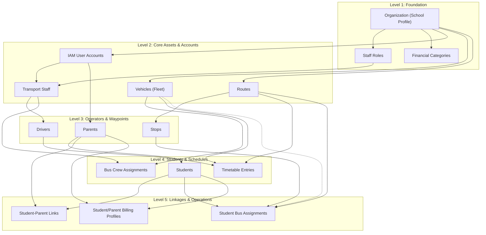
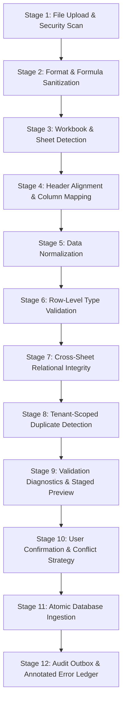
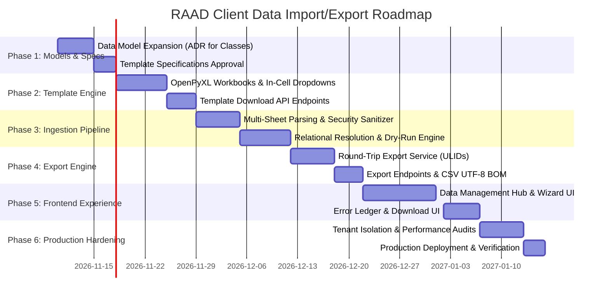

# RAAD-TECH — Deep System Audit & Client Data Import/Export Architecture Report

**Document ID:** RAAD-AUDIT-2026-11-IMPEXP  
**Classification:** Enterprise SaaS Architecture & System Audit  
**Author:** Senior Software Architect, Business Systems Analyst & Data Migration Specialist  
**Target Repository:** `RAAD-TECH` (FastAPI Modular Monolith + React/TypeScript Web Dashboard)  
**Status:** Architecture Specification & System Audit (Research Only — No Code Implemented)  
**Date of Audit:** November 5, 2026  

---

## 1. Executive Summary

### 1.1 Purpose and Scope
This technical and business audit provides an architectural blueprint for introducing an enterprise-grade **Client Data Collection, Excel Templates, Bulk Import, and Export Management System** into the RAAD-TECH platform. 

The primary business objective is to eliminate manual data entry during client onboarding, enabling schools and transport organizations to:
1. Download professionally branded and pre-configured Excel starter templates.
2. Enter comprehensive organizational, student, parent, staff, fleet, route, and financial data with clear guidance.
3. Upload workbooks for automated validation, phone normalization, duplicate detection, and relational integrity checking.
4. Review an interactive preview and validation diagnostics report prior to persistence.
5. Execute an atomic batch ingestion that establishes all cross-entity relationships automatically.
6. Export operational and historical school datasets into Excel/CSV formats with round-trip synchronization support.

### 1.2 Core Audit Findings
An exhaustive inspection of the RAAD-TECH codebase reveals:
* **Strong Foundations:**
  * Clean Hexagonal / DDD Architecture with 12 bounded contexts (`billing`, `fleet_device`, `iam`, `notifications`, `organization`, `platform_audit`, `platform_finance`, `reporting`, `school_erp`, `tracking`, `transport_ops`, `video`).
  * Strict multi-tenant isolation enforced at the repository layer via `TenantRegionScope` ([ADR-0021](file:///C:/Dev/RAAD-TECH/docs/architecture/adr/0021-tenant-scope-enforcement-at-repository-layer.md)).
  * Production-grade Excel generation infrastructure via `openpyxl>=3.1` (MIT License) already installed and bound to [reporting/infra/renderers.py](file:///C:/Dev/RAAD-TECH/backend/raad/modules/reporting/infra/renderers.py).
  * A single-entity bulk import prototype recently introduced in [transport_ops/application/import_services.py](file:///C:/Dev/RAAD-TECH/backend/raad/modules/transport_ops/application/import_services.py) and [transport_ops/api/imports_router.py](file:///C:/Dev/RAAD-TECH/backend/raad/modules/transport_ops/api/imports_router.py) (supporting basic student and parent templates).
  * Transactional topological flush ordering ([_flush_in_dependency_order](file:///C:/Dev/RAAD-TECH/backend/raad/core/db/unit_of_work.py#L162)) and transactional audit logging ([ADR-0007](file:///C:/Dev/RAAD-TECH/docs/architecture/adr/0007-audit-entries-write-architecture.md)).
* **Critical Architecture Gaps:**
  * **Absence of Multi-Sheet Workbook Processing:** Existing import only supports isolated single-table files; there is no capability to ingest a unified school master workbook.
  * **Missing Academic Structure in Database Schema:** While [ADR-0038](file:///C:/Dev/RAAD-TECH/docs/architecture/adr/0038-school-erp-scope-reversal.md) brought School ERP into scope, the database currently lacks tables for `academic_years`, `classes`, `grades`, and `sections`. Grade levels are currently packed into student `notes`.
  * **Missing Bi-Directional Export Engine:** Existing reporting exports formatted tabular reports for viewing, but lacks entity data exports with round-trip identifiers (`RAAD_SYSTEM_ID`) for offline editing and safe re-import.
  * **Synchronous Execution Bottleneck:** Ingestion executes synchronously inside FastAPI HTTP requests, risking gateway timeouts (e.g., Nginx 60s) on large school datasets (>500 students with IAM user provisioning and password hashing).
  * **No Persistent Import Job History:** No database tables exist to track import batches, author metadata, raw files, or historical error ledgers.
  * **No Excel In-Cell Validation:** Generated templates lack Excel dropdown lists, data validation rules, or locked reference tables.

### 1.3 High-Level Recommendation
We recommend a **Hybrid Template Architecture** supported by an enterprise **Data Transfer Bounded Context (`data_transfer`)**:
1. **Templates:** Provide both a multi-sheet **School Onboarding Master Workbook** (for greenfield onboarding) and targeted **Modular Templates** (for ongoing department-level updates).
2. **Template Technology:** Utilize `openpyxl` to inject cell-level validation dropdowns, date masks, text formatting (preserving leading zeros in Somali phone numbers), and locked header styling in RAAD brand colors (`#1E63FF`).
3. **Pipeline:** A 12-stage validation and reconciliation engine with dry-run previews, automated Somali phone E.164 normalization, in-memory duplicate resolution, and transactional persistence.
4. **Round-Trip Export:** Comprehensive exports with immutable ULIDs (`RAAD_SYSTEM_ID`) in Column A, allowing seamless bulk updates without record duplication.
5. **Frontend:** A dedicated **Client Data Management Center** (`/org/data-management`) combining a Template Download Center, Multi-step Import Wizard, Export Hub, and Batch History Audit Log.

---

## 2. Existing System Architecture Findings

### 2.1 Backend Architecture & Module Boundaries
RAAD-TECH is structured as a Python 3.11+ modular monolith running on FastAPI and SQLAlchemy 2.0 (asyncio with `asyncpg`). It strictly enforces domain-driven design (DDD) principles:
* **The 12 Bounded Contexts:**
  1. `organization` (C1): Tenant root, campuses/branches, regional boundaries.
  2. `iam` (C2): Identity, RBAC, users, sessions, authentication tokens.
  3. `fleet_device` (C3): Vehicles, GPS/MDVR terminals, cameras, device assignments.
  4. `tracking` (C4): JT808 telemetry, vehicle positions, online state, geofences.
  5. `transport_ops` (C5): Students, parents, drivers, routes, stops, trips, student bus assignments, transport staff, crew history, incidents.
  6. `video` (C6): JT1078 live video streaming, MDVR recording playback.
  7. `notifications` (C7): Multi-channel alerts (SMS, FCM push, in-app).
  8. `billing` (C8): RAAD SaaS subscription billing to Organizations (Plans, Subscriptions, Invoices).
  9. `reporting` (C9): Report catalogue, synchronous PDF/XLSX report rendering.
  10. `platform_audit` (C10): System settings, global audit log queries.
  11. `school_erp` (C11): School finance (fee plans, parent billing profiles, student billing profiles, parent invoices, parent payments, expenses, income).
  12. `platform_finance` (C12): RAAD internal operating finance and P&L.

```
                    +------------------------------------------------+
                    |           FastAPI HTTP Edge / API v1           |
                    +------------------------------------------------+
                                           |
                                           v
                    +------------------------------------------------+
                    |              Application Services              |
                    +------------------------------------------------+
                               /           |           \
                              /            |            \
                             v             v             v
             +------------------+  +---------------+  +------------------+
             |  transport_ops   |  |  school_erp   |  |   fleet_device   |
             +------------------+  +---------------+  +------------------+
                             \             |             /
                              \            |            /
                               v           v           v
                    +------------------------------------------------+
                    |          Shared Kernel / Unit of Work          |
                    |    (Topological Flush + Outbox + AuditWriter)  |
                    +------------------------------------------------+
                                           |
                                           v
                    +------------------------------------------------+
                    |           PostgreSQL 16 (Canonical DB)         |
                    +------------------------------------------------+
```

### 2.2 Layering Discipline & Architectural Gates
The codebase enforces strict architectural rules verified by automated architecture tests ([backend/tests/architecture/](file:///C:/Dev/RAAD-TECH/backend/tests/architecture/)):
1. **Domain Purity:** Domain entities never import SQLAlchemy, FastAPI, Pydantic, or any I/O library (`test_domain_never_imports_forbidden_frameworks`).
2. **Application Purity:** Application layer never imports SQLAlchemy or FastAPI directly (`test_application_never_imports_sqlalchemy_or_fastapi_directly`).
3. **Cross-Module Isolation:** No module may import another module's internal domain or infra layers (`test_no_module_imports_another_modules_domain_or_infra`). Cross-module entity references must use plain string IDs (`CHAR(26)` ULID), never database foreign keys.
4. **Dependency Direction:** Intra-module layers only depend inward: `api` -> `application` -> `domain` <- `infra`.

### 2.3 Multi-Tenancy & Tenant Isolation (ADR-0021)
* Every business table carries an indexed plain column `organization_id: CHAR(26)`.
* Tenant isolation is enforced at the repository layer via `TenantRegionScope` ([ADR-0021](file:///C:/Dev/RAAD-TECH/docs/architecture/adr/0021-tenant-scope-enforcement-at-repository-layer.md)).
* When a request arrives, `get_scope` in [interfaces/http/deps.py](file:///C:/Dev/RAAD-TECH/backend/raad/interfaces/http/deps.py) resolves the caller's allowed organizations. This scope is passed to the `UnitOfWork` and applied automatically to `SqlAlchemyRepositoryBase` on all `get_by_id`, `list_page`, `list_all`, and `list_scoped` calls.
* **Security Result:** One school cannot view, modify, or infer the existence of another school's records. Any access attempt outside scope returns `404 Not Found` (never `403`), eliminating IDOR enumeration vulnerabilities.

### 2.4 Transaction Management, Outbox, and Audit Logging
* **Atomic Unit of Work:** [SqlAlchemyUnitOfWork](file:///C:/Dev/RAAD-TECH/backend/raad/core/db/unit_of_work.py#L95) coordinates database transactions.
* **Topological Flush Ordering:** To prevent foreign-key violation errors caused by arbitrary SQLAlchemy mapper sorting, `_flush_in_dependency_order()` topologically sorts pending table inserts based on `MetaData.sorted_tables`.
* **Outbox & Audit Writing:** In the same database transaction, `UnitOfWork.commit()` persists:
  1. Business entity rows.
  2. Transactional outbox records ([OutboxWriter](file:///C:/Dev/RAAD-TECH/backend/raad/core/events/outbox.py)).
  3. Audit trail records ([AuditWriter](file:///C:/Dev/RAAD-TECH/backend/raad/core/audit/writer.py) via [ADR-0007](file:///C:/Dev/RAAD-TECH/docs/architecture/adr/0007-audit-entries-write-architecture.md)).

### 2.5 Background Jobs & Task Processing Status
* **Current Status:** No distributed message broker (Celery, Arq, or Redis Queue) is currently active for application background tasks.
* **Dependencies:** `redis>=5.0` is installed, but used strictly for JT808 vehicle position caching (`tracking.infra.adapters.RedisLatestPositionPort`).
* **Consequence:** Current operations (including report generation and bulk import commits) execute synchronously within the ASGI request-response cycle.

---

## 3. Existing Database Entities and Relationships

An exhaustive audit of the ORM models reveals the following entities relevant to client onboarding:

### 3.1 Entity Inventory Matrix

| Module | Table Name | ORM Model | Status | Key Columns & Identifiers | Relationships & Foreign Keys |
| :--- | :--- | :--- | :--- | :--- | :--- |
| `organization` | `organizations` | `OrganizationModel` | **EXISTING** | `id`, `name`, `org_type`, `status`, `lat`, `long`, `geofence_radius_m` | `parent_org_id` (self-FK for campuses), `region_id` (FK to `regions`) |
| `organization` | `regions` | `RegionModel` | **EXISTING** | `id`, `name`, `geographic_scope`, `status` | Regional boundaries for RAAD staff |
| `iam` | `users` | `UserModel` | **EXISTING** | `id`, `organization_id`, `role`, `email`, `phone`, `full_name`, `status` | Identity root for staff, drivers, and parents |
| `transport_ops` | `students` | `StudentModel` | **EXISTING** | `id`, `organization_id`, `full_name`, `external_ref`, `status`, `dob`, `gender`, `notes` | Cross-module reference to `organization_id` |
| `transport_ops` | `parents` | `ParentModel` | **EXISTING** | `id`, `organization_id`, `user_id`, `full_name`, `phone`, `alternate_phone`, `address`, `emergency_contact_name`, `emergency_contact_phone` | Cross-module ref to `users.id`, in-context child of `organization` |
| `transport_ops` | `student_parents` | `StudentParentModel` | **EXISTING** | `student_id`, `parent_id`, `relationship`, `is_primary` | Composite PK: FK to `students.id` and FK to `parents.id` |
| `transport_ops` | `transport_staff` | `TransportStaffModel` | **EXISTING** | `id`, `organization_id`, `full_name`, `phone`, `alternate_phone`, `employee_ref`, `role_id`, `start_date`, `status`, `emergency_contact_name`, `emergency_contact_phone` | In-context FK to `transport_staff_roles.id` |
| `transport_ops` | `transport_staff_roles`| `TransportStaffRoleModel`| **EXISTING** | `id`, `organization_id`, `name`, `sort_order`, `is_archived` | Unique on `(organization_id, name)` |
| `transport_ops` | `drivers` | `DriverModel` | **EXISTING** | `id`, `organization_id`, `user_id`, `staff_id`, `license_no`, `status` | FK to `transport_staff.id` (1:1), cross-module ref to `users.id` |
| `fleet_device` | `vehicles` | `VehicleModel` | **EXISTING** | `id`, `organization_id`, `plate_no`, `label`, `capacity`, `status` | Unique on `(organization_id, plate_no)` |
| `fleet_device` | `devices` | `DeviceModel` | **EXISTING** | `id`, `organization_id`, `terminal_id`, `model`, `vendor`, `imei`, `iccid`, `sim_msisdn`, `lifecycle_state` | Hardware assets managed by RAAD |
| `fleet_device` | `device_assignments`| `DeviceAssignmentModel` | **EXISTING** | `id`, `device_id`, `vehicle_id`, `assigned_at`, `unassigned_at` | FK to `devices.id`, FK to `vehicles.id` |
| `transport_ops` | `routes` | `RouteModel` | **EXISTING** | `id`, `organization_id`, `name`, `status` | Unique on `(organization_id, name)` |
| `transport_ops` | `stops` | `StopModel` | **EXISTING** | `id`, `organization_id`, `route_id`, `name`, `latitude`, `longitude`, `sequence_no`, `geofence_radius_m` | FK to `routes.id`. Unique on `(route_id, sequence_no)` |
| `transport_ops` | `student_assignments`| `StudentAssignmentModel`| **EXISTING** | `id`, `organization_id`, `student_id`, `route_id`, `pickup_stop_id`, `dropoff_stop_id`, `vehicle_id`, `status` | FKs to `students.id`, `routes.id`, `stops.id`. Partial unique index: 1 active assignment per student |
| `transport_ops` | `vehicle_staff_assignments`| `VehicleStaffAssignmentModel`| **EXISTING** | `id`, `organization_id`, `staff_id`, `vehicle_id`, `role_id`, `route_id`, `starts_on`, `ends_on`, `kind` | FK to `transport_staff.id`. Bus crew history |
| `transport_ops` | `route_timetable_entries`| `RouteTimetableEntryModel`| **EXISTING** | `id`, `organization_id`, `route_id`, `vehicle_id`, `trip_type`, `weekdays`, `planned_departure`, `default_driver_id` | FKs to `routes.id`, `drivers.id` |
| `school_erp` | `erp_student_billing_profiles`| `StudentBillingProfileModel`| **EXISTING** | `id`, `organization_id`, `student_id`, `monthly_fee`, `currency` | ADR-0048: Unique on `(organization_id, student_id)` |
| `school_erp` | `erp_parent_billing_profiles`| `ParentBillingProfileModel`| **EXISTING** | `id`, `organization_id`, `parent_id`, `due_day`, `billing_start_period`, `currency`, `status` | ADR-0042: Unique on `(organization_id, parent_id)` |
| `school_erp` | `erp_fee_plans` | `FeePlanModel` | **EXISTING** | `id`, `organization_id`, `name`, `amount`, `currency`, `status` | Fee catalogue definition |
| `school_erp` | `erp_financial_categories`| `FinancialCategoryModel`| **EXISTING** | `id`, `organization_id`, `name`, `kind`, `parent_category_id`, `status` | Chart of accounts for income/expense |
| `school_erp` | `classes` / `grades` | *None* | **MISSING** | No schema exists | Identified gap: academic structure is unmodeled |

### 3.2 Relational Entity-Dependency Graph
When onboarding a client school, entities must be populated according to their strict foreign key and business dependency order:



---

## 4. Existing Import/Export Capabilities

### 4.1 What is Already Implemented
1. **Bulk Ingestion Prototype:**
   * Handled in [import_services.py](file:///C:/Dev/RAAD-TECH/backend/raad/modules/transport_ops/application/import_services.py) and [imports_router.py](file:///C:/Dev/RAAD-TECH/backend/raad/modules/transport_ops/api/imports_router.py).
   * **Endpoints:**
     * `GET /api/v1/imports/{resource_type}/template`: Returns `.xlsx` or `.csv` starter template for `students` or `parents`.
     * `POST /api/v1/imports/{resource_type}/validate`: Dry-run validation of uploaded bytes without persistence; parses Excel/CSV, normalizes Somali phone numbers, checks for duplicates, and returns row errors and preview.
     * `POST /api/v1/imports/{resource_type}/commit`: Atomic batch commit. Upserts students (matching by `external_ref`) and parents (matching by `phone`), provisions `iam.User` logins for parents with temporary passwords, and establishes `student_parents` link records.
   * **Phone Normalizer:** `normalize_somali_phone()` normalizes 8-digit and 9-digit local numbers (`061...`, `61...`) to E.164 standard (`+252...`).
2. **Document & Report Rendering:**
   * Handled in [reporting/infra/renderers.py](file:///C:/Dev/RAAD-TECH/backend/raad/modules/reporting/infra/renderers.py) using `openpyxl` (Excel) and `reportlab` (PDF).
   * Generates styled tables with brand styling (`_BRAND = "1E63FF"`), auto-calculated column widths, borders, and metadata headers.
3. **Frontend Integration:**
   * [BulkImportDialog.tsx](file:///C:/Dev/RAAD-TECH/frontend/src/features/transport-ops/imports/BulkImportDialog.tsx) provides a 4-step modal: Upload -> Validate/Preview -> Commit -> Summary.
   * Mounted on [StudentsPage.tsx](file:///C:/Dev/RAAD-TECH/frontend/src/features/transport-ops/students/StudentsPage.tsx) and [ParentsPage.tsx](file:///C:/Dev/RAAD-TECH/frontend/src/features/transport-ops/parents/ParentsPage.tsx).

---

## 5. Missing Functionality and Identified Gaps

| Capability | Current State | Target State | Impact / Architectural Gap |
| :--- | :--- | :--- | :--- |
| **Multi-Sheet Master Workbook** | **MISSING** | One comprehensive workbook with sheets: School, Staff, Vehicles, Routes, Stops, Parents, Students, Assignments, Billing | Schools must currently download, fill, and upload multiple separate files with manual cross-referencing. |
| **Academic Structure (Classes/Grades)**| **MISSING** | Canonical database entities: `classes`, `academic_years`, `sections` | Grade levels are currently stored inside `students.notes` string; no structured academic hierarchy exists. |
| **Bi-directional Data Export Center** | **MISSING** | Entity data export with `RAAD_SYSTEM_ID` for bulk offline updates and re-import | Reports module generates display tables only; no re-importable raw data exports exist. |
| **Excel Cell Validation & Dropdowns** | **MISSING** | OpenPyXL data validation rules (`DataValidation`) with in-cell picklists for enums | Clients can enter invalid text (e.g., misspelled status or gender), requiring validation rejection. |
| **Formula Injection Protection** | **MISSING** | Sanitization of CSV/Excel cells starting with `=`, `+`, `-`, `@` | Potential security risk if an exported CSV with malicious formulas is opened in Microsoft Excel. |
| **Import Job & Error History Tracking** | **MISSING** | Persistent database tables `import_batches` and `import_batch_errors` | No audit history of previous imports; cannot download original error report after leaving modal. |
| **Interactive Column Mapping UI** | **MISSING** | UI step allowing users to map arbitrary spreadsheet columns to RAAD attributes | File upload strictly fails if headers do not match hardcoded template strings verbatim. |
| **Asynchronous Task Processing** | **MISSING** | Background worker handling file ingestion asynchronously for files > 500 rows | Large files risk HTTP timeout; browser must keep connection open during entire commit. |
| **Rollback / Undo Import Capability** | **MISSING** | Safe transaction rollback or batch soft-delete of ingested records | If a user imports 1,000 bad records, they must be cleaned manually or via database queries. |
| **Staff & Teacher Ingestion** | **PARTIAL** | Support non-transport employees, teachers, and administrators | Only transport staff (`transport_staff`) exists; general school faculty is unmodeled. |

---

## 6. Recommended Client Data Templates

To balance the needs of comprehensive onboarding versus routine operational updates, we recommend a **Dual-Template Strategy**:

```
                                  +------------------------------------+
                                  |     RAAD Client Template Suite     |
                                  +------------------------------------+
                                              /             \
                                             /               \
                                            v                 v
                 +--------------------------------+     +-------------------------------+
                 |  Master School Onboarding Kit  |     |   Modular Operational Kits    |
                 |  (Greenfield Complete Setup)   |     |   (Ongoing Department Ingest) |
                 +--------------------------------+     +-------------------------------+
                 | * Multi-sheet workbook         |     | * Template 1: Students & Fam  |
                 | * 8 Interconnected worksheets  |     | * Template 2: Fleet & Drivers |
                 | * Full relational resolution   |     | * Template 3: Routes & Stops  |
                 | * Ideal for new client setup   |     | * Template 4: Staff Roster    |
                 +--------------------------------+     | * Template 5: Finance & Fees  |
                                                        +-------------------------------+
```

### 6.1 Template 1: Master School Onboarding Workbook (Multi-Sheet)
* **Target Audience:** School Principals, IT Directors, RAAD Implementation Engineers.
* **Worksheet Composition:**
  1. `00_Instructions`: Visual guide, color legend, Somali phone format instructions, required field checklist.
  2. `01_School_Profile`: School details, campus branch name, address, geofence coordinates.
  3. `02_Staff_Roster`: Teachers, transport coordinators, bus attendants, drivers, license numbers.
  4. `03_Fleet_Vehicles`: Bus plate numbers, internal bus labels, capacity, operational status.
  5. `04_Routes_and_Stops`: Route names, stop names in sequence, geofence radius, approximate coordinates.
  6. `05_Parents_Guardians`: Full name, primary phone, alternate phone, address, emergency contact details.
  7. `06_Students`: Full name, admission number, gender, date of birth, parent primary phone (foreign key), grade.
  8. `07_Transport_Assignments`: Student admission number, assigned route, pickup stop, dropoff stop, bus plate.
  9. `08_Fee_Structures`: Student admission number, monthly transport fee, currency, payment due day.
  10. `99_Lookups` (Hidden / Locked): Reference lists backing all Excel data validation dropdowns.

### 6.2 Template 2: Students & Guardians Fast-Track Template
* **Target Audience:** School Admissions Office.
* **Columns:**
  * `full_name` (Required, text <= 200)
  * `admission_number` (Required, unique external_ref <= 64)
  * `grade_level` (Optional, text <= 40)
  * `gender` (Required, dropdown: `male`, `female`, `other`)
  * `date_of_birth` (Optional, date `YYYY-MM-DD`)
  * `parent_name` (Required, text <= 200)
  * `parent_phone` (Required, normalized Somali phone `061...` or `+252...`)
  * `parent_email` (Optional, valid email format)
  * `relationship` (Optional, dropdown: `Father`, `Mother`, `Guardian`, `Other`)
  * `address` (Optional, text <= 255)
  * `emergency_contact_name` (Optional, text <= 200)
  * `emergency_contact_phone` (Optional, normalized phone)
  * `medical_or_transit_notes` (Optional, text <= 500)

### 6.3 Template 3: Fleet & Transportation Template
* **Target Audience:** Transport Manager / Logistics Coordinator.
* **Sheets/Tables:**
  * **Vehicles:** `plate_no` (Required, unique), `label` (e.g. "Bus 05"), `capacity` (Integer > 0), `status` (dropdown: `active`, `maintenance`).
  * **Routes:** `route_name` (Required, unique), `status` (dropdown: `active`, `inactive`).
  * **Stops:** `route_name` (FK), `sequence_no` (Integer 1..N), `stop_name`, `latitude` (DECIMAL), `longitude` (DECIMAL), `geofence_radius_m` (default: 50).
  * **Crew Assignments:** `plate_no` (FK), `driver_employee_ref` (FK), `attendant_employee_ref` (FK), `assignment_type` (`permanent`, `temporary`).

### 6.4 Template 4: Transport Staff & Drivers Template
* **Target Audience:** HR / Transport Operations.
* **Columns:**
  * `full_name` (Required, text <= 200)
  * `employee_ref` (Optional, unique employee ID <= 64)
  * `phone` (Required, normalized Somali phone)
  * `role_name` (Required, dropdown: `Driver`, `Bus Attendant`, `Transport Coordinator`)
  * `is_driver` (Required, dropdown: `Yes`, `No`)
  * `license_number` (Required if `is_driver` is `Yes`, text <= 64)
  * `start_date` (Optional, date `YYYY-MM-DD`)
  * `emergency_contact_name` (Optional)
  * `emergency_contact_phone` (Optional)

### 6.5 Template 5: Student Billing & Fee Setup Template
* **Target Audience:** School Bursar / Finance Office.
* **Columns:**
  * `admission_number` (Required, FK to Student)
  * `monthly_fee` (Required, Numeric >= 0, e.g. `45.00`)
  * `currency` (Required, dropdown: `USD`, `SOS`)
  * `billing_start_period` (Required, format `YYYY-MM`)
  * `due_day_of_month` (Required, integer `1` to `28`)
  * `opening_balance` (Optional, Numeric, prior unpaid balance if migrating mid-year)

---

## 7. Recommended Excel Workbook Structure & Capabilities

### 7.1 Visual Styling & Usability Design
To deliver an enterprise user experience, templates generated by RAAD must adhere to strict visual and technical specifications:
* **Branding Palette:**
  * Header fill: RAAD Primary Blue `#1E63FF` (`openpyxl.styles.PatternFill("solid", fgColor="1E63FF")`).
  * Header typography: Pure white (`#FFFFFF`), Bold, 10pt JetBrains Mono / Arial.
  * Required field indicator: Column header marked with `*` and colored in soft red accent or clear text indicator.
  * Zebra striping on sample rows: Alternating row fill `#F7F8FA`.
  * Grid lines: Explicit thin border `#E2E6EC` to ensure readability across all versions of Excel.
* **Data Formatting Rules:**
  * **Phone Columns:** Explicitly set cell formatting to Text (`@`). This prevents Microsoft Excel from stripping leading zeros (e.g. turning `0615123456` into the integer `615123456`).
  * **Date Columns:** Formatted as `yyyy-mm-dd`.
  * **Money / Amount Columns:** Formatted as `#,##0.00`.
  * **Column Widths:** Dynamically sized to `max(max_content_length + 4, 14)` to prevent truncated text display (`###`).

### 7.2 Excel Data Validation (In-Cell Dropdowns)
Using OpenPyXL's `DataValidation` class, workbooks will feature built-in dropdown picklists that constrain inputs directly inside Excel:

```python
# OpenPyXL In-Cell Validation Architecture
from openpyxl.worksheet.datavalidation import DataValidation

# Enum picklist for Gender
gender_dv = DataValidation(
    type="list", 
    formula1='"male,female,other"', 
    allow_blank=True,
    promptTitle="Select Gender",
    prompt="Choose from the allowed options"
)
worksheet.add_data_validation(gender_dv)
gender_dv.add("D2:D1000")  # Applied to data rows
```

### 7.3 Sheet Protection & Formula Safeguards
* **Header Protection:** Worksheet protection enabled (`ws.protection.sheet = True`) with empty password, locking headers and instructions from being modified or renamed while leaving data entry rows unlocked.
* **Lookups Sheet:** A dedicated worksheet (`99_Lookups`) containing dynamic lists (existing routes, bus plates, staff roles) set to `hidden` or `veryHidden` to prevent client tampering.

---

## 8. Proposed Import Engine Architecture

### 8.1 The 12-Stage Ingestion Pipeline
The import engine must execute a deterministic 12-stage pipeline to ensure complete data integrity:



### 8.2 Detailed Stage Specifications

#### Stage 1: File Upload & Security Scan
* Accepts multipart file upload (`.xlsx` or `.csv`).
* Enforces file size limit: Max 15 MB.
* Enforces row limits: Max 5,000 rows per sheet.
* Validates magic bytes (`PK\x03\x04` for OpenXML `.xlsx`; UTF-8 / ASCII for `.csv`).

#### Stage 2: Format & Formula Sanitization
* **Formula Injection (CSV/Excel DDE) Defense:** Scans every text cell. If a cell begins with `=`, `+`, `-`, `@`, `\t`, or `\r`, the parser prepends a single quote (`'`) or strips the character to prevent code execution when opened in Excel.
* **Decompression Bomb Protection:** Configures OpenPyXL with `defusedxml` to prevent XML Entity Expansion (Billion Laughs attack).

#### Stage 3: Workbook & Sheet Detection
* Identifies whether the file is a **Multi-Sheet Master Workbook** or a **Single-Entity File**.
* Reads sheet names and maps them to internal schema parsers (`Students` -> `StudentParser`, `Vehicles` -> `VehicleParser`).

#### Stage 4: Header Alignment & Column Mapping
* Matches header rows using fuzzy string matching and alias dictionaries:
  * e.g., `"Phone Number"`, `"Mobile"`, `"Telephone"`, `"Contact"`, `"Tel"` all map to canonical field `phone`.
  * e.g., `"Adm No"`, `"Admission #"`, `"Student ID"`, `"Reg No"` map to canonical field `admission_number`.

#### Stage 5: Data Normalization
* **Somali Phone Normalization:** Cleans formatting characters (`()`, `-`, spaces). Automatically formats valid 8- and 9-digit Somali numbers to standard E.164 (`+252...`).
* **Date Parsing:** Automatically detects and converts ISO `YYYY-MM-DD`, European `DD/MM/YYYY`, US `MM/DD/YYYY`, and Excel numeric epoch serial dates.
* **Currency & Monetary Amounts:** Strips symbols (`$`, `USD`, `SOS`, commas) and parses directly into `Decimal` (never binary float).
* **Text Trimming:** Strips leading/trailing whitespace and collapses multiple consecutive spaces.

#### Stage 6: Row-Level Type Validation
* Validates field lengths against database constraints (`VARCHAR(200)` for names, `VARCHAR(64)` for license/external_ref, `VARCHAR(32)` for plates).
* Enforces enum values against canonical domain value objects (`Gender`, `StudentStatus`, `PaymentMethod`, `VehicleStatus`).

#### Stage 7: Cross-Sheet Relational Integrity
* In multi-sheet mode, cross-references references between sheets in memory:
  * e.g., If Student row specifies `parent_phone: 0615123456`, verifies that this phone exists in the `Parents` sheet or in the active organization database.
  * e.g., If Student Assignment specifies `route_name: North Route`, verifies that "North Route" is defined in the `Routes` sheet or existing DB routes.

#### Stage 8: Tenant-Scoped Duplicate Detection
* **In-File Duplicates:** Identifies duplicate admission numbers, vehicle plates, or parent phone numbers within the uploaded spreadsheet itself.
* **Database Duplicates:** Queries existing records within the caller's `TenantRegionScope`:
  * Existing Student by `external_ref`.
  * Existing Parent by normalized `phone`.
  * Existing Vehicle by `plate_no`.
  * Existing Staff by `employee_ref` or `phone`.

#### Stage 9: Validation Diagnostics & Staged Preview
* Generates a structured JSON diagnostic payload:
  * `total_rows`, `valid_rows`, `invalid_rows`, `warning_rows`.
  * Itemized error list: `sheet_name`, `row_number`, `column`, `error_message`, `severity` (`FATAL`, `WARNING`).
  * 10-row sample preview table showing parsed, normalized data alongside error flags.

#### Stage 10: User Confirmation & Conflict Strategy
* User reviews diagnostics in UI and selects an ingestion policy:
  * **Option A (Strict / All-or-Nothing):** Abort entire import if any fatal error exists.
  * **Option B (Skip Invalid Rows):** Ingest all valid rows and generate a downloadable Excel report containing only the rejected rows with error explanations.
  * **Option C (Upsert Mode):** If an entity exists in the database, update its attributes; if new, insert it.

#### Stage 11: Atomic Database Ingestion
* Executes inside a single `SqlAlchemyUnitOfWork` session.
* Inserts records in topological dependency order using `_flush_in_dependency_order()`.
* Provisions IAM `User` accounts for new Parents and Staff with hashed temporary passwords and `is_password_change_required = True`.
* If any database constraint violation occurs, the entire transaction rolls back cleanly.

#### Stage 12: Audit Outbox & Annotated Error Ledger
* Emits domain events (`StudentEnrolled`, `ParentRegistered`, `StudentParentLinked`, `VehicleRegistered`) to the outbox table.
* Writes audit log entries to `audit_entries` via `AuditWriter`.
* If invalid rows were skipped, generates an **Annotated Error Workbook** with a highlighted Column `A` (`Error Diagnostic`) for the client to correct and re-upload.

---

## 9. Proposed Export Engine Architecture

### 9.1 Round-Trip Data Synchronization
To eliminate duplicate records when clients export data, modify it offline, and re-import it, RAAD must implement **Round-Trip Identifiers**:

```
+-----------------------------------------------------------------------------------------+
|                                    EXPORTED EXCEL FILE                                  |
+---------------------+-------------------+---------------------+-------------------------+
| RAAD_SYSTEM_ID      | Admission Number  | Full Name           | Parent Phone            |
| (Locked ULID)       | (Business Key)    | (Editable)          | (Editable)              |
+---------------------+-------------------+---------------------+-------------------------+
| 01JCP8A1B2C3D4E5F6  | ADM-2026-001      | Ahmed Ali Hassan    | +252615123456           |
| 01JCP8A9X8Y7Z6W5V4  | ADM-2026-002      | Maryam Omar Farah   | +252615654321           |
+---------------------+-------------------+---------------------+-------------------------+
```

1. **System Identifier in Column A:** Every exported entity row includes its immutable ULID `id` labeled as `RAAD_SYSTEM_ID`.
2. **Re-Import Reconciliation Logic:**
   * When a file is uploaded, the engine inspects Column A:
     * If `RAAD_SYSTEM_ID` is present and matches an existing record in the caller's tenant scope, the engine performs an **in-place update** (preserving created dates, audit history, and foreign keys).
     * If `RAAD_SYSTEM_ID` is blank or absent, the engine treats the row as a **new entity** and generates a new ULID.

### 9.2 Export Module Coverage

| Export Target | Formats | Scoping & Filters | Exported Attributes | Excluded / Masked Attributes |
| :--- | :--- | :--- | :--- | :--- |
| **Complete School Backup** | `.xlsx` (Multi-sheet) | Tenant Scope | All modules in relational sheets | Sensitive IAM passwords, tokens |
| **Students Roster** | `.xlsx`, `.csv` | Status, Grade, Route | ID, Admission No, Name, Gender, DOB, Parent Contacts, Active Bus/Stop | Internal DB audit versions |
| **Parents Directory** | `.xlsx`, `.csv` | Status | ID, Name, Phone, Alt Phone, Address, Emergency Contacts, Linked Children | Password hashes, session tokens |
| **Transport Staff & Crew**| `.xlsx`, `.csv` | Role, Status | ID, Name, Phone, Role, Employee Ref, License No, Assigned Bus | Driver login credentials |
| **Fleet & Routes** | `.xlsx`, `.csv` | Vehicle Status | Plate No, Bus Label, Capacity, Assigned Terminal ID, Route Name, Stop Count | MDVR video authentication keys |
| **Student Billing Roster**| `.xlsx`, `.csv` | Billing Period, Status | Student Name, Admission No, Monthly Fee, Currency, Parent Name, Due Day | Credit card / payment gateway secrets |

### 9.3 Security, Privacy & Sanitization in Exports
* **Strict Tenant Scoping:** Exports always pass through `TenantRegionScope` (ADR-0021). A school can never export data belonging to another institution.
* **PII Protection & Least Privilege:**
  * Password hashes, salt strings, session tokens, MFA secrets, and terminal video authentication keys are strictly excluded from all export serialization models.
* **CSV Character Encoding:** CSV files are encoded with UTF-8 BOM (`\ufeff`) to ensure Somali names with diacritics and Arabic characters render correctly in Microsoft Excel across all operating systems.

---

## 10. Frontend / User Experience Architecture

### 10.1 Navigation & Placement
In the Organization Dashboard ([frontend/src/app/layout/navConfig.ts](file:///C:/Dev/RAAD-TECH/frontend/src/app/layout/navConfig.ts)), client onboarding and data tools will be anchored under a dedicated navigation entry:

```typescript
// Proposed navConfig entry for Org Admin
header("Data Management"),
link("Data Import & Export", Database, "/org/data-management"),
```

In addition, contextual **"Import"** and **"Export"** action buttons will be placed in the header toolbar of existing pages:
* `/org/students` -> Opens Import Wizard pre-set to "Students".
* `/org/parents` -> Opens Import Wizard pre-set to "Parents".
* `/org/staff` -> Opens Import Wizard pre-set to "Staff".
* `/org/vehicles` -> Opens Import Wizard pre-set to "Fleet".

### 10.2 Proposed Screen Structure (`/org/data-management`)
The Data Management Center will feature a clean tabbed layout conforming to RAAD's Design System (`AppShell`, `manrope`/`sora` typography, `#1E63FF` accents):

```
+----------------------------------------------------------------------------------------------------+
|  Data Management Center                                                       [ Download Templates ]|
|  Manage bulk data ingestion, official templates, and school data exports                           |
+----------------------------------------------------------------------------------------------------+
|  [ Import Wizard ]   |   [ Download Templates ]   |   [ Export Data ]   |   [ Import History ]     |
+----------------------------------------------------------------------------------------------------+
|                                                                                                    |
|   Step 1: Upload File  ----->  Step 2: Validation Preview  ----->  Step 3: Commit & Finish         |
|                                                                                                    |
|   +--------------------------------------------------------------------------------------------+   |
|   |                       Drag & Drop Completed Excel / CSV Template                           |   |
|   |                            Supports .xlsx, .csv (Max 15 MB)                                |   |
|   |                                                                                            |   |
|   |                            [ Browse Local Files ]                                          |   |
|   +--------------------------------------------------------------------------------------------+   |
|                                                                                                    |
+----------------------------------------------------------------------------------------------------+
```

### 10.3 The Multi-Step Import Wizard User Flow
1. **Step 1: Template & Upload:**
   * User selects the resource type (or "Master Onboarding Workbook").
   * Quick-download link for the official starter template.
   * File dropzone with instant client-side format and size checks.
2. **Step 2: Validation & Staged Preview:**
   * Visual summary cards: Total Rows, Valid Rows (Green), Invalid Rows (Red), Warnings (Yellow).
   * Interactive Data Table: Rows rendered with status badges. Clicking an invalid row reveals exact cell error callouts.
   * Reconciliation Controls: Dropdown to toggle "Abort on any error" vs "Skip invalid rows and proceed".
3. **Step 3: Execution & Progress:**
   * Progress bar with animated state indicator (`Processing rows...`, `Provisioning parent accounts...`, `Committing transaction...`).
4. **Step 4: Completion & Error Ledger:**
   * Success metrics: Created, Updated, Skipped counts.
   * If any rows were skipped: One-click download button for `Annotated_Errors_[Timestamp].xlsx`.

---

## 11. Security, Multi-Tenancy and Data Integrity Assessment

### 11.1 Security Threat Matrix & Mitigations

| Threat Vector | Risk Description | Severity | Architecture Mitigation |
| :--- | :--- | :--- | :--- |
| **Cross-Tenant Data Leak (IDOR)** | Malicious school uploads records referencing another school's bus/route IDs or attempts to export another school's roster | **CRITICAL** | All queries strictly bind `TenantRegionScope` ([ADR-0021](file:///C:/Dev/RAAD-TECH/docs/architecture/adr/0021-tenant-scope-enforcement-at-repository-layer.md)). Cross-tenant IDs resolve to `None` / `404`. Import commands strictly override `organization_id` with `principal.org_id`. |
| **Formula Injection (CSV/Excel DDE)** | Spreadsheet cells containing `=CMD\|' /C calc'!A0` execute arbitrary commands on admin workstations when opened | **HIGH** | Parser sanitizes all string cells starting with `=`, `+`, `-`, `@` by prepending a safe apostrophe (`'`). |
| **Decompression Bomb (Zip Bomb)** | Malicious compressed `.xlsx` file expands to hundreds of gigabytes in RAM, crashing the server | **HIGH** | OpenPyXL invoked with XML bomb protections; maximum uncompressed size capped at 50 MB; streaming parser mode used. |
| **Credential & PII Exposure** | Student dates of birth, parent phone numbers, or staff personal data leaked via public endpoints | **HIGH** | Import/Export endpoints require explicit RBAC permissions (`data_transfer.import`, `data_transfer.export`). Passwords hashed before persistence. |
| **Race Conditions on Concurrent Import** | Two school admins upload student rosters simultaneously, producing duplicate sequence numbers | **MEDIUM** | Distributed Redis lock keyed on `lock:import:{organization_id}:{resource_type}` ensures only one active import executes per tenant at a time. |
| **Partial Import Data Corruption** | Server crashes mid-import after creating 200 of 500 students, leaving orphan links and broken crew assignments | **CRITICAL** | Strict transactional boundary (`SqlAlchemyUnitOfWork`). Either all valid rows commit atomically or the database rolls back to the pre-import state. |

---

## 12. Recommended Technical Architecture

### 12.1 Module Organization: The `data_transfer` Context
Rather than bloating `transport_ops` with cross-cutting concerns spanning finance, fleet, IAM, and logistics, we recommend establishing a dedicated **`data_transfer` Bounded Context** in `backend/raad/modules/data_transfer/`:

```
backend/raad/modules/data_transfer/
├── __init__.py
├── api/
│   ├── deps.py               # Dependency injection & RBAC checks
│   ├── routers.py            # HTTP routes for templates, imports, exports
│   └── schemas.py            # Pydantic request/response models
├── application/
│   ├── ports.py              # Ports for cross-module coordination
│   ├── template_engine.py    # OpenPyXL template generator with validations
│   ├── import_engine.py      # Multi-stage parsing & normalization pipeline
│   ├── export_engine.py      # Entity serializer with round-trip ULIDs
│   └── validation_rules.py   # Business rule & constraint evaluators
├── domain/
│   ├── entities.py           # ImportBatch, ImportBatchRow aggregates
│   └── value_objects.py      # ImportStatus, FileFormat, ConflictStrategy
└── infra/
    ├── excel_adapters.py     # OpenPyXL reader/writer implementations
    ├── csv_adapters.py       # Python CSV streaming adapters
    ├── models.py             # ORM models for import_batches
    └── repositories.py       # SQLAlchemy persistence for import audit logs
```

### 12.2 Library Selection Justification
* **Excel Processing (Writer & Reader): `openpyxl>=3.1`**
  * *Verdict:* **APPROVED & ALREADY INSTALLED**.
  * *Rationale:* Pure Python, zero native C-extension dependencies, MIT licensed, already vetted in `pyproject.toml` for [reporting/infra/renderers.py](file:///C:/Dev/RAAD-TECH/backend/raad/modules/reporting/infra/renderers.py). Supports full styling, data validation, hidden sheets, and streaming read mode (`read_only=True`).
* **CSV Processing: Python Standard Library `csv`**
  * *Verdict:* **APPROVED**.
  * *Rationale:* Built into Python 3.11, zero overhead, highly optimized in C, supports UTF-8 with BOM (`utf-8-sig`).
* **Client-side Parsing: React Hook Form + TanStack Table**
  * *Verdict:* **APPROVED & ALREADY INSTALLED**.
  * *Rationale:* Already standard across the frontend dashboard.

---

## 13. Required API Endpoints Specification

### 13.1 Templates API
* `GET /api/v1/data-transfer/templates`
  * *Summary:* List available starter templates.
  * *Permission:* `data_transfer.templates.read`
  * *Response:* List of templates (Master, Students, Fleet, Staff, Finance) with version, sheet descriptions, and column schemas.
* `GET /api/v1/data-transfer/templates/{template_key}/download`
  * *Summary:* Download starter template workbook.
  * *Query Params:* `format` (`xlsx` | `csv`).
  * *Response:* Binary file stream with `Content-Disposition: attachment; filename="RAAD_Template_{key}.xlsx"`.

### 13.2 Bulk Import API
* `POST /api/v1/data-transfer/imports/validate`
  * *Summary:* Dry-run validation of uploaded workbook (no DB writes).
  * *Request:* Multipart form data containing file bytes.
  * *Response:* Diagnostic summary (`total_rows`, `valid_rows`, `invalid_rows`, `errors[]`, `preview[]`).
* `POST /api/v1/data-transfer/imports/commit`
  * *Summary:* Execute atomic batch ingestion.
  * *Request:* Multipart form data with file bytes + query parameter `conflict_strategy` (`abort_on_error` | `skip_invalid` | `upsert`).
  * *Response:* Ingestion summary (`batch_id`, `created_count`, `updated_count`, `skipped_count`, `error_report_available`).
* `GET /api/v1/data-transfer/imports/batches`
  * *Summary:* List previous import batches for the organization.
  * *Permission:* `data_transfer.imports.history`
* `GET /api/v1/data-transfer/imports/batches/{batch_id}/errors`
  * *Summary:* Download annotated Excel error workbook containing rejected rows and error reasons.

### 13.3 Bulk Export API
* `POST /api/v1/data-transfer/exports`
  * *Summary:* Generate an entity dataset export.
  * *Request Body:* JSON specifying `dataset_key` (`school_master`, `students`, `parents`, `fleet`, `staff`, `finance`), `format` (`xlsx` | `csv`), and optional filters.
  * *Response:* Binary download stream with round-trip `RAAD_SYSTEM_ID` columns.

---

## 14. Testing and Quality Assurance Strategy

```
+----------------------------------------------------------------------------------+
|                            RAAD Testing Pyramid Strategy                         |
+----------------------------------------------------------------------------------+
|  E2E / Workflow Tests: Complete Onboarding Flow (Download -> Fill -> Import)     |
|  ------------------------------------------------------------------------------  |
|  Integration Tests: Multi-Table Dependency Order, Transaction Rollback, Outbox   |
|  ------------------------------------------------------------------------------  |
|  Contract Tests: API Contract Whitelist, Tenant Scope Enforcement (ADR-0021)    |
|  ------------------------------------------------------------------------------  |
|  Unit Tests: Phone Normalizer, Formula Sanitizer, OpenPyXL Generator, Validators |
+----------------------------------------------------------------------------------+
```

### 14.1 Unit Testing Suite
* **Phone Normalizer:** Tests Somali phone variations: `0615123456`, `+252615123456`, `00252615123456`, `615123456`, spaces, hyphens, and invalid inputs.
* **Formula Injection Sanitizer:** Tests malicious prefixes (`=cmd`, `@SUM`, `+1`, `-5`) ensuring they are neutralized with apostrophes.
* **Date Parsing Suite:** Tests ISO, UK, US, and Excel numeric serial dates.
* **OpenPyXL Template Builder:** Asserts workbook structure, sheet titles, column header styling, locked protection, and DataValidation rule ranges.

### 14.2 Integration & Transactional Rollback Tests
* **Simulated Constraint Failure:** Uploads a batch of 100 students where row 99 violates a unique constraint; verifies that zero students, zero parents, and zero IAM user accounts remain in the database after rollback.
* **Topological Flush Order Test:** Verifies that Parents, Staff, and Routes are flushed and obtain IDs before Students, Drivers, and Stops attempt to link to them.

### 14.3 Multi-Tenant Isolation Tests (ADR-0021)
* As Org Admin of "School A", attempts to import a Student assigned to a Route belonging to "School B". Verifies that the route is rejected as non-existent (`404` / Unresolved Reference).
* As Org Admin of "School A", attempts to export data. Verifies that zero records from "School B" appear in the resulting Excel file.

---

## 15. Performance Considerations & Large Dataset Benchmarking

1. **Memory Management during Excel Parsing:**
   * Standard OpenPyXL DOM parsing loads the entire XML tree into RAM (~10x the file size).
   * For files with > 1,000 rows, invoke `openpyxl.load_workbook(..., read_only=True, data_only=True)`. This streams rows as generators, reducing memory consumption from 150 MB down to < 10 MB.
2. **Password Hashing Latency Optimization:**
   * Password hashing (Bcrypt / Argon2) takes ~100-200ms per user by design to prevent brute force attacks.
   * If an import creates 500 parents, sequential hashing would freeze the request for 50 to 100 seconds!
   * *Mitigation:* Execute password hashing in parallel using Python's `asyncio.gather()` or offload to background task worker.
3. **Database Pre-Fetching (N+1 Elimination):**
   * Instead of executing a database query per row to check if an admission number or parent phone exists, the engine executes **one bulk query** per sheet at Stage 8:
     ```python
     # Bulk pre-fetch within tenant scope
     existing_students = await uow.students.list_all()
     students_by_ref = {s.external_ref: s for s in existing_students if s.external_ref}
     ```
   * All duplicate checks and lookups occur in-memory in $O(1)$ time.

---

## 16. Phased Implementation Roadmap



### Phase 1: Data Model Expansion & Template Specifications
* Formulate ADR for Academic Structure (`academic_years`, `classes`, `sections`).
* Author migration to expand `StudentModel` with structured `class_id` foreign key.
* Finalize column mapping specifications for the 5 official templates.

### Phase 2: Professional Excel Template Generation Engine
* Implement `TemplateGeneratorService` in `data_transfer` module using `openpyxl`.
* Build branded templates with `#1E63FF` headers, locked instruction sheets, and in-cell `DataValidation` dropdowns.
* Expose `GET /api/v1/data-transfer/templates/{key}/download`.

### Phase 3: Ingestion Engine & Dry-Run Validation
* Build the multi-sheet parser with formula injection sanitization.
* Implement cross-sheet relational linking and organization duplicate detection.
* Build the dry-run validation endpoint returning row-level diagnostics and preview data.

### Phase 4: Bi-Directional Export Engine with Round-Trip Synchronization
* Build `ExportEngineService` supporting multi-sheet `.xlsx` and UTF-8 BOM `.csv`.
* Embed immutable `RAAD_SYSTEM_ID` (ULID) in Column A to enable safe re-import and in-place updates.

### Phase 5: Frontend UI/UX Integration
* Build `/org/data-management` center with tabbed navigation.
* Implement the 4-step Import Wizard dialog with live diagnostic tables and conflict resolution selectors.
* Connect Export Center with date, route, and status filters.

### Phase 6: Security Hardening, Verification & Rollout
* Execute multi-tenant isolation tests, large dataset memory benchmarks (5,000 rows), and transaction rollback verification.
* Seed permissions in `role_permissions` for `org_admin`.

---

## 17. Risk Analysis & Technical Challenges

| Risk | Impact | Probability | Mitigation Strategy |
| :--- | :--- | :--- | :--- |
| **Excel Cell Type Coercion** (Excel stores dates as numbers or changes phone formats) | High | High | Explicitly set text format `@` on phone columns in OpenPyXL; use flexible multi-format date parser (`_parse_date()`) that accepts ISO, slash-delimited, and numeric epochs. |
| **User Password Hashing Delay** (Large parent batches cause request timeouts) | High | Medium | Execute hashing asynchronously in parallel worker pools; implement batch chunking of 250 records per sub-transaction. |
| **Client-Side Merged Cells or Blank Rows** | Medium | High | Parser strips empty trailing rows automatically; parser unmerges cells and replicates top-left value across range. |
| **Database Lock Contention** | Medium | Low | Use PostgreSQL `READ COMMITTED` isolation with fine-grained row locks; batch pre-checks prevent long-lived table locks. |

---

## 18. Final Architectural Recommendation

The RAAD-TECH platform is in an exceptional state of architectural readiness to host an enterprise Client Data Collection, Template Generation, Bulk Import, and Export system. 

1. **Foundational Readiness:** The existing architecture already provides the core prerequisites: clean DDD modular isolation, `openpyxl` rendering infrastructure, strict tenant scoping via [ADR-0021](file:///C:/Dev/RAAD-TECH/docs/architecture/adr/0021-tenant-scope-enforcement-at-repository-layer.md), and transactional outbox/audit mechanics via [ADR-0007](file:///C:/Dev/RAAD-TECH/docs/architecture/adr/0007-audit-entries-write-architecture.md).
2. **Unified Bounded Context:** Client data transfer should be encapsulated within a dedicated `data_transfer` bounded context rather than fragmenting across individual modules.
3. **Dual-Template Strategy:** Offer both the **Master School Onboarding Workbook** (multi-sheet) and **Modular Operational Templates** (single-domain).
4. **Round-Trip Data Integrity:** Enforce immutable ULIDs (`RAAD_SYSTEM_ID`) in Column A of exports to guarantee seamless offline modification and duplicate-free re-import.
5. **Security First:** Strict formula injection sanitization, memory-efficient streaming parsing, and automated Somali phone E.164 normalization ensure data entering RAAD is reliable, clean, and enterprise-grade.

This blueprint equips the RAAD-TECH engineering team to execute the implementation with zero architectural debt, zero security regressions, and maximum business impact for school onboarding.
